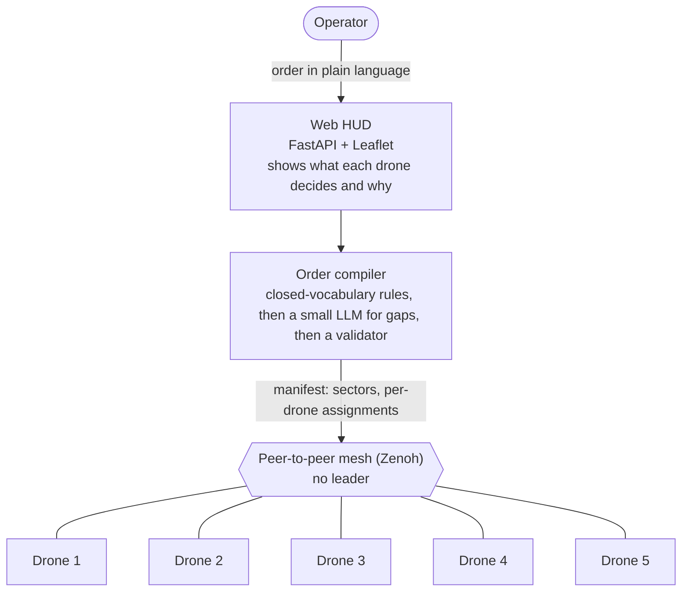

# Decentralized swarm coordination under electronic warfare

> A simulation prototype of a coordination layer for small drone groups (**ISR and coordination only**). The group keeps doing its job when the operator link and GPS are jammed and when drones are lost. No leader and no central planner in flight: an operator gives one order in plain language, and the drones split the work between themselves.

**Status, stated plainly.** Simulation only (PX4 SITL + Gazebo Harmonic, 5 drones). No hardware, no field data, no users. One author. AI coding assistants wrote much of the implementation from my specifications; I treat all of it as unverified until it passes against simulator ground truth. Every number below says how it was measured and how many runs it had.

---

## 1. Why this exists: what the war changed

Radio is the weak point of a small drone.

- RUSI's February 2025 assessment of the war's third year describes Russian electronic warfare as dense along the front and reports Ukrainian estimates of roughly 10,000 drones lost per month to EW and other counter-drone means ([coverage](https://www.unmannedairspace.info/counter-uas-systems-and-policies/ukrainian-drone-losses-at-10000-a-month-new-research-from-rusi/)). The figure comes from interviews, one analyst called it likely overstated, and it is not a jamming-only number.
- The IISS describes GPS as often effectively unavailable near the front line ([IISS dossier, March 2026](https://www.iiss.org/globalassets/media-library---content--migration/files/publications---free-files/strategic-dossier/uavs-2026/iiss_uavs-isr-deterrence-and-war_032026.pdf)).
- Spoofing is the nastier case: a jammed drone loses its way, a spoofed drone flies where the enemy wants it to ([Ukrainska Pravda, quoting a navigation developer](https://www.pravda.com.ua/eng/news/2026/01/28/8018266)).

The responses so far are **per drone**: fibre-optic FPVs that cannot be jammed but are tied to a cable (10-20 km is cited) and to a cable supply ([RFE/RL](https://www.globalsecurity.org/wmd/library/news/ukraine/2025/03/ukraine-250312-rferl03.htm), [TWZ](https://twz.com/news-features/inside-ukraines-fiber-optic-drone-war)), and onboard autonomy for the last segment of a flight when the link degrades ([review, Dec 2025](https://www.newgeopolitics.org/2025/12/28/ukraines-deftech-at-the-end-of-2025-from-drone-mass-to-systems-warfare/)). These make one drone harder to stop. They do not coordinate a group.

**Coordination is the gap, and a buyer says so.** In January 2026 the US Defense Innovation Unit and DAWG launched a prize challenge worth up to $100 million for an "orchestrator" that turns a commander's intent, given by voice or text, into execution across whole formations of vehicles. It must work under intermittent connectivity and must show operators what the system is doing and what communications they actually have, so they do not wrongly assume they still have control ([DIU](https://www.diu.mil/latest/diu-and-dawg-launch-autonomous-vehicle-orchestrator-prize-challenge), [Breaking Defense](https://breakingdefense.com/2026/01/diu-offers-100m-in-prizes-for-voice-controlled-ai-enabled-drone-swarm-orchestrator/)).

## 2. The hypothesis

**The scarce resource is shifting from airframes to operator attention and to coordination that survives degraded communications.** A layer that lets one operator state intent once, lets the group divide the work without a leader, degrades gracefully under jamming and losses, and explains each decision, should multiply what one operator can do.

I turned that into testable claims and recorded which ones held:

| # | Claim | Verdict | Evidence |
|---|---|---|---|
| H1 | A leaderless auction layer keeps a group useful when links degrade and drones die | **Supported in simulation, with limits** | Scenarios 05 and 07; one run each of the hard cases (section 4) |
| H2 | A plain-language order can be compiled safely: deterministic rules for the closed vocabulary, a small LLM only for what the text leaves open, a validator on every result | **Supported on a 20-order set** | LLM alone 4/20 fully correct, rules plus post-check 20/20 (`scripts/verify_tasking.py`) |
| H3 | Fast explicit rules (System 1, 5 Hz, no LLM) plus a slow small model as advisor only in severe phases (System 2) | **Partly** | Rules are numbered and logged; advisor quality is **not measured** |
| H4 | GPS-denied flight stays usable on camera-based odometry, and GPS spoofing is caught | **Supported** | Position error against Gazebo truth; detection in 3-4 s (section 4) |
| H5 | More drones means more useful emergent behaviour | **Not supported** | The literature I checked shows thresholds and optima, not monotonic growth. I tested 5 drones only, so scaling is open |

H5 was my own starting belief. Writing it down as a falsifiable claim and then reading the evidence against it is part of the project.

## 3. What I built



Inside every drone (`docker/drone-agent/swarm/`):

| Part | What it does | Where |
|---|---|---|
| Auction | CBAA/CBBA-style task auction over the mesh; zero bids are never selected, which is how per-drone assignments are enforced | `coordinator.py`, `cbaa.py`, `bids.py`, `orders.py` |
| System 1 | Nine explicit numbered rules R1-R9 (condition, action, urgency), evaluated at 5 Hz with no LLM; the rule id goes into every decision log | `rules.py`, `matcher.py`, `phase.py` |
| System 2 | A 0.5B model that advises only in severe phases (loss of the group, critical navigation); every command passes a validator | `planner_bridge.py`, `actions.py` |
| Order compiler | Zones and drone references come from rules, never from the model; the model fills only fields the text does not state | `order_rules.py`, `tasking.py`, `manifest_check.py` |
| Navigation | Camera-based visual odometry as the fallback when GPS is denied, plus a GPS-spoofing check (CUSUM on GPS velocity against visual velocity) | `vio_node.py`, `flow.py`, `gps_check.py` |
| Liveness | Peer death from direct heartbeats plus gossip, with an adaptive threshold on a lossy channel | `coordinator.py`, `features.py` |

Around the swarm:

- **Web HUD** (`docker/web-hud/`): map, per-drone state, an event feed with the reasoning behind each decision, EW controls. Manual: [`docs/HUD_MANUAL.md`](docs/HUD_MANUAL.md).
- **EW emulation** (`docker/ew-injector/`, `docker/drone-agent/ew/ew_agent.py`): jamming of the control link, GPS denial and drift, and degraded mesh, built on nftables because the kernel has no netem. It models packet loss and rate limits, not radio propagation.
- **Scenarios** (`scenarios/*.yaml`): control-link cut, GPS denial, mesh degradation, full EW, and cascades where GPS drifts, the mesh degrades and drones are removed.
- **Addressed orders**: `Drones 1 and 2 search Delta and Foxtrot, the rest stay in Alpha` pins sectors to drones. Checked on the simulator: drones 1 and 2 flew only Delta and Foxtrot, the Alpha group flew only Alpha.

## 4. Evidence (what was measured)

| Result | How it was measured | Caveat |
|---|---|---|
| Without GPS, position error stayed at 0.5-3.3 m maximum over about 180 s on all 5 drones | Against Gazebo ground truth, not the HUD | One run set. Later demo runs: 0.0-0.8 m after 30 s without GPS. Four runs, not statistics |
| GPS spoofing (drift 2 m/s) detected in 3.4 s and 3.8 s, with no false alarms on unaffected drones | Live run `spoof3` against Gazebo | One run. Drift under about 0.5 m/s is not caught: the tolerance is conservative |
| Plain-language orders: 4/20 with the model alone, 20/20 with rules plus post-check | `scripts/verify_tasking.py`, same 20 orders | A 20-order set, not a benchmark |
| Cascade with mesh degradation: after three drones were removed, the survivors marked them dead within 2 s, the advisor split the sector about 9 s later and ordered return about 18 s after that | `scenarios/07_cascade_mesh_l2.yaml`, one flight | One run. Mesh degradation on this rig is packet loss only |
| Keep-alive traffic per drone dropped from about 1,340 to about 2 packets per second | Packet counts before and after fixing a Zenoh setting | Measured on the emulated network |
| Camera rate 12.7 to 14.9 Hz (nominal 15) | Replaced render-based rangefinders with geometry-based ones | Details in `docs/gz_leak/REPORT.md` |
| 302 agent tests and 52 HUD tests pass on a plain Python install, no ROS or WSL | Fresh virtualenv, see section 8 | Host tests are not flight tests |

## 5. Four debugging stories

1. **An emulation artifact that looked like a weakness.** Packet loss injected on the sender made the whole swarm declare its neighbours dead within 4 seconds. I started from a packet capture instead of hypotheses: dropping at the output hook returns a send error to the sender, and Zenoh tears the link down. The same loss on the receive side never broke the link. The weakness was in my test rig, not in the swarm. Fix in `docker/drone-agent/ew/ew_agent.py`.
2. **A setting that meant something else.** `keep_alive` in Zenoh is a count per lease, not milliseconds. The agents sent about 1,340 one-byte packets per second each, and with the fix about 2. This also reduced false "peer dead" events, though not to the threshold I set.
3. **A stall in the upstream library.** Sometimes a drone's listener stopped accepting peers for good. I traced it to a wait in Zenoh's UDP link code that never ends when a connection closes while datagrams for it are still queued, found the conditions that trigger it (a container resumed from pause, mostly under packet loss), and added a watchdog that restarts the coordinator when the receive queue stops draining. An upstream bug report is drafted in [`docs/ZENOH_UDP_LISTENER_STALL.md`](docs/ZENOH_UDP_LISTENER_STALL.md) and not yet sent.
4. **Numbers I had to retract.** Early navigation results turned out to be computed over a pose log that mixed several runs. I found the cause (a cleanup command killed its own shell), fixed the script, recomputed, and marked the old figures as unreliable in [`docs/HANDOFF_OPEN_PROBLEMS.md`](docs/HANDOFF_OPEN_PROBLEMS.md) instead of deleting them.

That file is the working log of the whole project, including what is still broken.

## 6. What does not work yet

- **Simulation only, 5 drones.** Nothing here has flown. Scaling beyond 5 is untested; the all-to-all heartbeat is an implementation choice that will not scale, not a law.
- **The EW emulation is packet loss, not radio.** No delay and no correlated loss, so jamming results are indicative only.
- **False "peer dead" events under heavy mesh degradation** are reduced but still above my own threshold at 80% loss.
- **Detecting a real drone loss under impaired links is slower** by roughly 4 seconds because of the adaptive threshold.
- **System 1 stays quiet on slow GPS drift while visual odometry holds the position.** Deliberate for now, and documented.
- **System 2 (the advisor) is unmeasured.** I can show that it is gated and validated, not that its advice is good.
- **The operator console is one entry point for orders.** It compiles the order on every drone and aligns the results by majority. In flight there is no leader, but the order itself comes from one place.
- **Security is partial.** A shared swarm key and a short HMAC without nonce remain; a protocol change is needed.
- Mixed languages: parts of the docs and logs are in Russian.

## 7. Scope and ethics

ISR and coordination only. The system has no weapon functions and I will not add any. A human issues the order and stays in command; the HUD is built so the operator can see what each drone decides and why. The demo map is fictional and the targets are synthetic: nothing here uses information about real units, positions or people.

I have no combat or military-procurement experience. This was built from public sources, and a real deployment would need operators, domain experts and export-control advice that I do not have.

## 8. Run it

**Run the tests (about two minutes; no ROS or WSL needed; verified on Windows with Python 3.12).**

```bash
git clone https://github.com/polikuj101/decentralized-swarm-intelligence-for-drones.git
cd decentralized-swarm-intelligence-for-drones
python -m venv .venv && source .venv/bin/activate        # Windows: .venv\Scripts\activate
pip install pytest "numpy<2" "fastapi==0.115.*" httpx "pydantic==2.*" "uvicorn[standard]==0.30.*" \
            pymavlink "eclipse-zenoh>=1.0,<2" "onnxruntime>=1.18,<2" tokenizers opencv-python-headless pyyaml
(cd docker/drone-agent && PYTHONPATH=. python -m pytest tests -q --ignore=tests/test_injection.py)   # 302 passed
(cd docker/web-hud && python -m pytest tests -q)                                                       # 52 passed
```

**Run the full simulator.** Heavy and tested on one machine only: Windows 11 with WSL2 (Ubuntu 22.04) and Docker, 16 cores, a 10 GB WSL memory limit.

```bash
cp .env.example .env && ./scripts/preflight.sh      # creates tokens
make fetch-embedder                                  # downloads the embedding model
./scripts/swarm_fresh.sh                             # PX4 first, then the agents
# open http://127.0.0.1:8000 and give an order within 90 s (the default MANIFEST_WAIT_S;
# put MANIFEST_WAIT_S=900 in .env to wait 15 minutes), for example:
#   "Drones 1 and 2 search Delta and Foxtrot, the rest stay in Alpha"
DEMO_AUTOPILOT=1 ./scripts/run_demo.sh               # or run the scripted EW scenario instead
```

Before the first run read the traps section ("Ловушки", in Russian) of [`CLAUDE.md`](CLAUDE.md): each item cost hours.

## 9. Repository map

```
docker/drone-agent/   swarm logic: coordinator, auction, System 1 and 2, navigation, tests
docker/web-hud/       operator console (FastAPI + Leaflet), tests
docker/ew-injector/   electronic-warfare emulation service
docker/px4-sitl/      PX4 flight controller in simulation
docker/simulator-core/ Gazebo world, models, range-sensor simulator
scenarios/            EW and cascade scenarios (YAML)
scripts/              bring-up, demo, regression and measurement scripts
docs/                 HANDOFF_OPEN_PROBLEMS.md (working log), HUD_MANUAL.md, nav_runs/ (raw run logs)
```

## 10. What this says about how I work

- **I start from the operator's problem, not the technology**, and write down what would prove me wrong.
- **I check results against ground truth** (simulator poses, packet captures) rather than against my own dashboard.
- **I keep an honest log**: what broke, what I got wrong, what is unmeasured. A claim without a run count does not go in.
- **I debug to the root cause**, including in someone else's library, and ship a workaround while the real fix is pending.
- **I design for the person in the loop**: every decision carries a rule id and a reason, and the interface says what the swarm is doing and what it cannot do.
- **I use AI tools heavily and verify their output**: they write code from my specifications, and nothing counts until it passes against measured reality.
